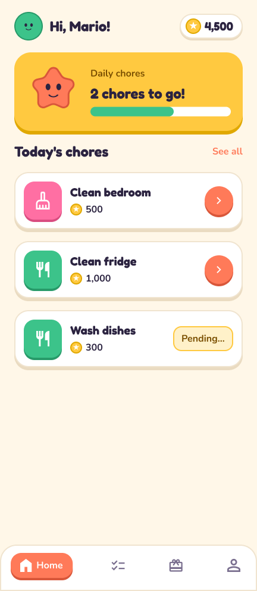
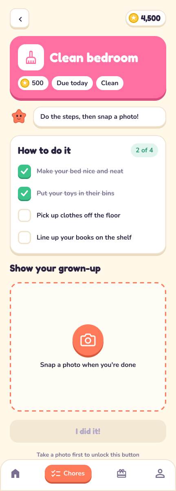
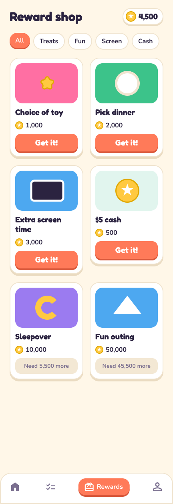

<p align="center">
  
</p>

<h1 align="center">ChorePal</h1>

<p align="center"><em>Chores, checked by AI. Rewards, earned for real.</em></p>

---

### **Project Description**
ChorePal is a mobile application designed to modernize and gamify household management. Parents assign chores to their children, kids prove the work with before/after photos that are checked by AI (and then the parent), and approved chores pay out coins into a **virtual wallet** that kids spend in a household reward shop. By bridging the gap between work and reward, ChorePal encourages accountability in the household.

<p align="center">
  
  &nbsp;&nbsp;
  
  &nbsp;&nbsp;
  

</p>

---

### **Features**
**For parents**
*   Create chores with a category, steps, due date, reward amount, and who it's for
*   Review submitted chores: before/after photos, the AI's verdict, then **Approve** (pays out coins) or **Ask to redo** with a note
*   Edit or delete a chore before the child has submitted it
*   Run a household **reward shop**, and see redeemed rewards **to hand out** - mark each one as given
*   See each kid's progress and coin balance at a glance

**For kids**
*   A daily chore list with Today / Upcoming, plus Pending and Done tabs
*   A step-by-step checklist and camera flow for each chore (before photo -> do the steps -> after photo)
*   Spend coins in the reward shop and track whether each reward has been handed over yet
*   Kid-friendly logins by **username** - password-reset codes go to the parent's inbox

---

### **Technologies Used**
*   **Frontend:** React Native + Expo (Expo Router), TypeScript - runs on iOS, Android, and web
*   **Backend:** Supabase - PostgreSQL with row-level security, Auth, and Edge Functions (Deno)
*   **AI verification:** Claude API (vision) compares each chore's before and after photos
*   **Cloud Storage:** AWS S3 for chore photos (uploaded via signed URLs)
*   **Testing:** Jest + React Native Testing Library
*   **Design:** Figma (design system and screens)
*   **Tools:** VS Code, Git/GitHub, Node.js

---

### **How It Works**
1.  A parent creates a chore. Each household is linked by a 7-character **secret code** that kids enter when they join.
2.  The child takes a **before** photo, does the steps, then takes an **after** photo. Photos upload to S3 through the `get-upload-url` edge function.
3.  The `verify-with-ai` edge function sends both photos to Claude, which judges whether the chore actually got done and writes kid-friendly feedback.
4.  If it passes, the chore waits for the parent. Approving it runs the `approve_chore` database function, which credits the child's wallet and logs a transaction. Otherwise the child gets the AI's feedback and can try again.
5.  Kids redeem rewards with their coins; the parent marks each one as given once it's handed over.

---

### **Installation Instructions**

1.  **Clone the repository:**
    ```bash
    git clone https://github.com/MVPs-ChorePal/chorepal.git
    cd chorepal
    ```

2.  **Install dependencies:**
    ```bash
    cd Application/Frontend
    npm install
    ```

3.  **Environment variables:** `Application/Frontend/.env` needs:
    ```
    EXPO_PUBLIC_SUPABASE_URL=
    EXPO_PUBLIC_SUPABASE_KEY=          # the Supabase anon/publishable key
    EXPO_PUBLIC_AWS_S3_BUCKET_NAME=
    EXPO_PUBLIC_AWS_REGION=
    ```
    The edge functions read their own secrets from Supabase (`ANTHROPIC_API_KEY`, `MY_AWS_ACCESS_KEY_ID`, `MY_AWS_SECRET_ACCESS_KEY`, `MY_AWS_REGION`, `MY_AWS_S3_BUCKET_NAME`).

4.  **Database (only when there are new migrations):** from `Application/Backend`, with the Supabase CLI linked to the project:
    ```bash
    npx supabase db push
    ```

---

### **How to Run the Application**
ChorePal is built using the Expo framework, allowing for easy testing on web or mobile devices.

1.  **Start the development server** (from `Application/Frontend`):
    ```bash
    npx expo start
    ```
    If the app behaves strangely after pulling new code, clear the cache with `npx expo start -c`.

2.  **View the app:**
    *   **Web:** Press `w` in the terminal to open the app in your browser.
    *   **Mobile:** Download the **Expo Go** app on your phone and scan the QR code displayed in the terminal.

---

### **Testing**
Automated tests live in `Application/Frontend/__tests__`, covering the auth screens and every parent and child screen. Run them from `Application/Frontend`:
```bash
npm test          # Jest + React Native Testing Library
npx tsc --noEmit  # type-check
npm run lint      # ESLint
```
---

### **More**
*   [Figma Design](https://www.figma.com/design/DzekBPRM1Yl9mPLJu6i15R/ChorePal?node-id=706-8&t=b7cipbOYJnklzTH2-0)
